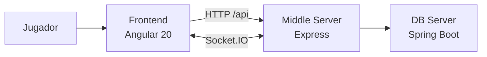

<div align="center">

# 🖥️ Viking Clan Wars · Frontend

### El campo de batalla, en tus manos.

**La aplicación web para comandar tu clan y jugar en tiempo real.**

[](https://angular.dev/)
[](https://www.typescriptlang.org/)
[](https://web.dev/explore/progressive-web-apps)

[Proyecto completo](https://github.com/agb4455/tfm) · [Motor de juego](https://github.com/agb4455/ProyectoIntermodularDamServidorIntermedio) · [Persistencia](https://github.com/agb4455/ProyectoIntermodularDamBackend)

</div>

---

## ⚔️ La interfaz de la guerra

Este repositorio contiene el cliente web de **Viking Clan Wars**. Desde aquí, los jugadores crean su identidad, se unen a partidas y gestionan sus acciones durante la batalla. La aplicación se comunica con el Middle Server mediante HTTP y Socket.IO.

Incluye lobby, autenticación, selección de personajes y clanes, partida en tiempo real, estadísticas, ranking y vistas de administración. La aplicación también incorpora configuración PWA para su instalación en dispositivos compatibles.

## 🧭 Cómo encaja en el sistema



El cliente no accede directamente a PostgreSQL ni MongoDB. Las acciones de juego y la sincronización en tiempo real pasan por el Middle Server; la persistencia se realiza detrás de este, a través del DB Server.

## 🛠️ Tecnologías

| Área | Tecnología |
|---|---|
| Aplicación | Angular 20.3, TypeScript 5.9, RxJS |
| Tiempo real | Socket.IO Client 4.8 |
| Interfaz | Angular standalone, estilos SCSS, traducciones ES/EN |
| PWA | Angular Service Worker y Web App Manifest |
| Pruebas | Karma, Jasmine y Angular CLI |

## 🚀 Desarrollo local

### Requisitos

- Node.js compatible con Angular 20 (recomendado: Node.js 22)
- npm

### Instalar y arrancar

```bash
npm install
npm start
```

Abre [http://localhost:4200](http://localhost:4200). Para ejecutar el servidor de desarrollo accesible desde otros contenedores o dispositivos de la red:

```bash
npm start -- --host 0.0.0.0
```

Para una experiencia integrada con API, motor e infraestructura, usa el [orquestador](https://github.com/agb4455/tfm) y su Compose de desarrollo. El servicio Angular del orquestador ya arranca el servidor escuchando en `0.0.0.0:4200`.

## 📜 Comandos

| Comando | Acción |
|---|---|
| `npm start` | Servidor de desarrollo Angular. |
| `npm run build` | Compilación de producción en `dist/`. |
| `npm test` | Tests unitarios con Karma/Jasmine. |
| `npm run watch` | Compilación de desarrollo en modo observación. |
| `npm run doc:build` | Genera documentación de código con Compodoc. |
| `npm run doc:serve` | Sirve la documentación generada. |

## 🗂️ Mapa del código

```text
src/
├── app/
│   ├── core/       # Autenticación, configuración, juego, sockets, i18n y estado
│   ├── pages/      # Inicio, lobby, partida, ranking, estadísticas y administración
│   └── shared/     # Componentes y servicios reutilizables
├── assets/         # Configuración cargada por la aplicación
└── styles/         # Tokens y variables de diseño
public/
├── icons/          # Iconos de la PWA
├── avatars/        # Avatares disponibles
└── manifest.webmanifest
```

## 🔌 Integración y configuración

- La API HTTP y las conexiones Socket.IO pertenecen al **Middle Server**.
- En el orquestador, el proxy Nginx enruta `/api/` y `/socket.io/` al motor y sirve la aplicación web.
- `src/assets/config.json` contiene `middleServerUrl`; en el repositorio está vacío para que el cliente pueda usar la configuración del mismo origen. Si cambias la topología, revisa esta configuración y la del proxy antes de desplegar.
- En desarrollo integrado, utiliza el `docker-compose.dev.yml` del orquestador, que levanta el frontend en el puerto `4200` junto con los servicios necesarios.

## 📱 Aplicación instalable

El proyecto incluye manifest, iconos y configuración de Service Worker para producción. La caché está pensada para recursos de la aplicación; las partidas requieren conexión activa para la sincronización en tiempo real. Para validar cambios de PWA, consulta `pwa-validation.mjs` y prueba una compilación de producción servida por HTTPS o `localhost`.

## 🔗 Ecosistema

- [Orquestador y despliegue](https://github.com/agb4455/tfm)
- [Middle Server — motor y sockets](https://github.com/agb4455/ProyectoIntermodularDamServidorIntermedio)
- [DB Server — persistencia](https://github.com/agb4455/ProyectoIntermodularDamBackend)

## 📄 Licencia

Consulta [`LICENSE`](./LICENSE) para las condiciones de uso del proyecto.

<div align="center">

**Estrategia en tiempo real. Estética de saga.**

</div>
